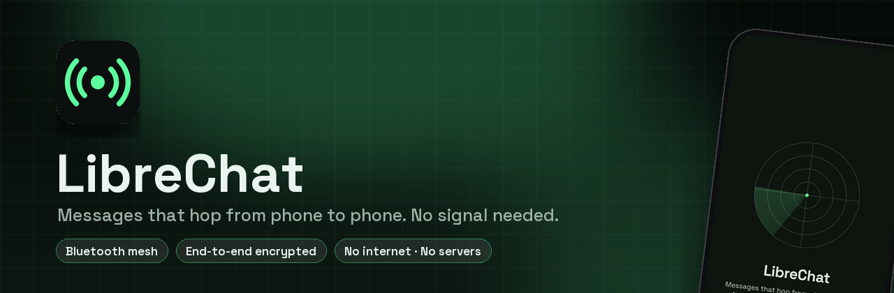
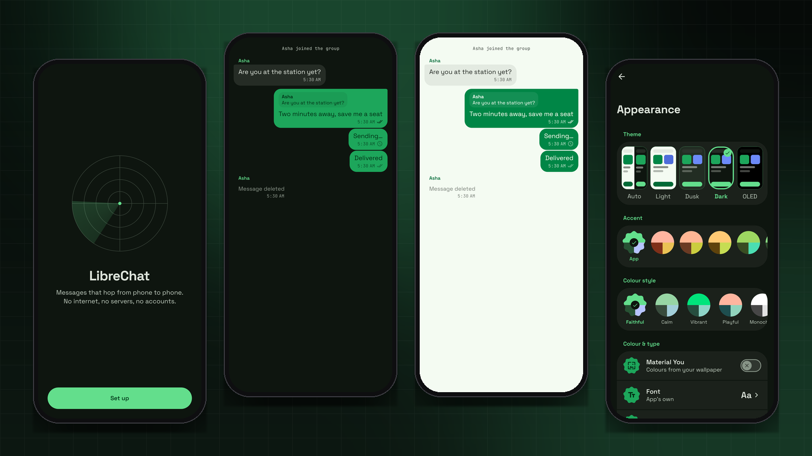
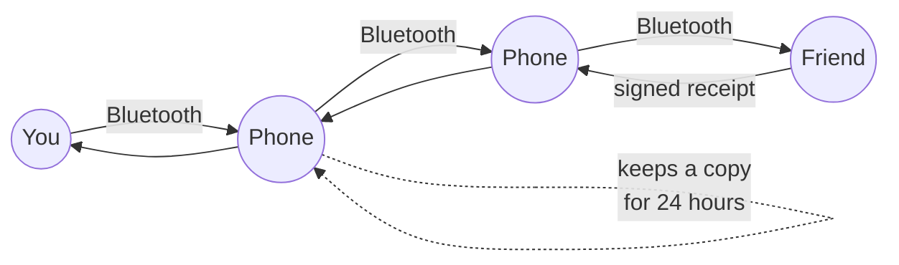

<div align="center">



<br><br>

[](https://developer.android.com)
[](https://kotlinlang.org)
[](https://developer.android.com/compose)
[](LICENSE)
[](https://prempoddar.github.io/LibreChat/)

**[Website](https://prempoddar.github.io/LibreChat/)** · **[Download](https://github.com/PremPoddar/LibreChat/releases)** · **[Privacy](https://prempoddar.github.io/LibreChat/privacy/)** · **[Report a problem](https://github.com/PremPoddar/LibreChat/issues)**

</div>

---

**An off-grid messenger. No internet, no servers, no accounts.** At a festival, on a hike, in a
building with no signal or during an outage: open LibreChat and everyone nearby running it forms a
mesh. A message to someone out of range is carried by the phones in between, and if there's no path
right now, they hold it for up to a day and pass it on when one appears. Everything private is end to
end encrypted.

<p align="center"></p>
<p align="center"><sub>Real screens, drawn by the app's own code.</sub></p>

## ✨ Highlights

| | |
|---|---|
| 📡 **Public chat** | Everyone in range, signed so nobody can post as you. |
| 🔒 **Direct messages** | End to end encrypted with forward secrecy (X3DH and Double Ratchet). |
| 👥 **Groups** | Encrypted once for everyone with Sender Keys; keys rotate when someone leaves. |
| 📷 **Photos &amp; voice notes** | Compressed for the mesh, encrypted, and sped up over Wi-Fi Aware when phones are side by side. |
| ✓✓ **Receipts** | Sent, delivered (acknowledged across the mesh), read. |
| ↩️ **Replies, reactions, delete for everyone** | |
| ⏱️ **Disappearing messages** | 1 hour, 1 day or 1 week, on both phones. |
| ✅ **Verification** | Scan each other's QR code or compare a 60-digit safety number. |
| ✋ **Requests &amp; blocking** | Strangers land in Requests; blocked people are dropped (but still relayed for others). |
| 🛰️ **Nearby radar** | Who's in range, who's reachable through the mesh, and how strong the link is. |
| 🔐 **On the phone** | SQLCipher database and encrypted media, keys guarded by Android Keystore; app lock; encrypted backups. |

## 🧭 How it works



```
 ┌───────────────── this phone ─────────────────┐
 │ UI (Compose) ── Room over SQLCipher           │
 │      │                                        │
 │ engine/Messenger   sessions, groups, receipts │
 │      │                                        │
 │ crypto/  X3DH · Double Ratchet · Sender Keys  │
 │      │                                        │
 │ mesh/Router   dedupe · hop limit · store and  │
 │      │        forward · acknowledgements      │
 │ protocol/  Packet (protobuf) · BLE framing    │
 └──────┼────────────────────────────┼───────────┘
   BLE GATT (server + client)   Wi-Fi Aware data path
```

### The mesh

Every phone is both a Bluetooth GATT server (advertising the LibreChat service) and a client (scanning
for it). Phones announce themselves every 15 seconds with their public keys and name, signed. Packets
are flooded with duplicate suppression and a hop limit of 7, except direct messages to a phone that is
itself a neighbour, which go straight to it. Each phone keeps a copy of what it relays for 24 hours and
hands it to every new neighbour once. Recipients send signed acknowledgements, which also let relays
drop their copies.

When two phones that both support **Wi-Fi Aware** are near each other, they open a Wi-Fi data path and
the router prefers it, so photos and voice notes move in seconds instead of minutes.

### The encryption

Implemented from Signal's published specifications on BouncyCastle's primitives (X25519, Ed25519,
ChaCha20-Poly1305, HKDF-SHA256):

- **Identity:** an Ed25519 signing key and an X25519 key bound to it. Your mesh id is a hash of the
  signing key.
- **Starting a chat:** X3DH using the recipient's signed prekey from their announcement, so no server is
  needed. First messages carry the prekey header until the other side replies.
- **Every message after that:** Double Ratchet, with out-of-order delivery and skipped-message keys.
  Simultaneous first messages from both sides are handled.
- **Groups:** Sender Keys (hash ratchet plus a signature per message), shared over the pairwise
  sessions and replaced whenever membership changes.
- **Public chat:** signed, not encrypted.

What relays can see: the sender and recipient mesh ids (or the group id), sizes and timing.

> **This implementation has not had an independent security audit.** It is tested against the RFC test
> vectors for every primitive and with end to end tests of every flow (see below).

## 🔐 Permissions and privacy

| Permission | Why |
|---|---|
| Nearby devices (Bluetooth) | Finding and linking with other phones. On Android 10 and 11 Android files this under location. |
| Nearby Wi-Fi devices | Wi-Fi Aware links (optional). |
| Notifications | New messages (optional). |
| Microphone, camera | Voice notes and scanning QR codes, asked for when first used. |
| Internet | Only for the local sockets of Wi-Fi Aware links. LibreChat never contacts a server. |

Full policy: **[prempoddar.github.io/LibreChat/privacy](https://prempoddar.github.io/LibreChat/privacy/)**.

## 🛠️ Building and testing

Requires JDK 17 or 21 for Gradle.

```bash
./gradlew assembleDebug
./gradlew testDebugUnitTest
```

- `crypto/`: RFC 7748, 8032, 5869, 4231 and 8439 test vectors; X3DH; Double Ratchet (out of order,
  skipped, replay, tampering, serialisation); sessions (simultaneous start, replayed first message);
  Sender Keys (forgery, replay, late joiners); media encryption; encrypted backups.
- `protocol/` and `mesh/`: packet codec, signatures, framing, routing, store-and-forward,
  acknowledgement and retry behaviour.
- `engine/`: whole flows over an in-memory mesh of three phones where A and C can only reach each other
  through B: public chat, delivery ticks, requests, read receipts, waiting for an unknown recipient,
  store-and-forward, lost-ack repair, reactions, delete, groups (including removal and admin hand-over),
  photos, re-requesting lost media pieces, disappearing messages, blocking, forged announcements.

Bluetooth and Wi-Fi Aware need real phones: install on two or three and walk apart.

## 📄 License

[Apache 2.0](LICENSE). Space Grotesk and JetBrains Mono are used under the SIL Open Font License.
